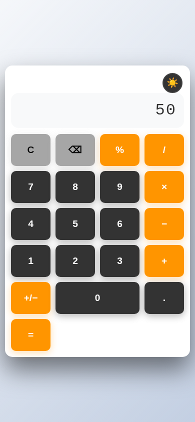
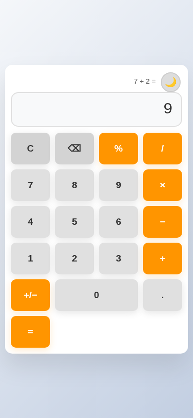

# Calculadora digital

Calculadora web hecha con HTML, CSS y JavaScript puro, pensada para usarse cómodamente desde el teléfono.

[](LICENSE)
[](https://nickpro5677.github.io/Calculadora-digital/)

👉 **Pruébala aquí:** https://nickpro5677.github.io/Calculadora-digital/

<p>
  
  
</p>

## Funciones

- Suma, resta, multiplicación y división, con operaciones encadenadas (`2 + 3 + 4 =` da `9`).
- Aviso claro al dividir entre cero.
- Decimales, cambio de signo (±), porcentaje y borrar el último dígito.
- Resultados redondeados para evitar errores como `0.1 + 0.2 = 0.30000000000000004`.
- Tema claro/oscuro que se recuerda entre visitas.
- Línea con la última operación realizada.
- Vibración al tocar los botones (en teléfonos compatibles).
- Soporte de teclado en computadora.

## Cómo usarla

**Desde el teléfono:** abre la [demo en vivo](https://nickpro5677.github.io/Calculadora-digital/) en el navegador. No hay que instalar nada.

**En una computadora:** descarga o clona el repositorio y abre `index.html` en el navegador (doble clic). No hace falta servidor.

### Atajos de teclado

| Tecla | Acción |
|-------|--------|
| `0`–`9`, `.` o `,` | Escribir número / decimal |
| `+` `-` `*` (o `x`) `/` | Operadores (sumar, restar, multiplicar, dividir) |
| `Enter` o `=` | Calcular resultado |
| `Backspace` | Borrar último dígito |
| `Escape` o `Supr` | Limpiar todo (C) |
| `%` | Porcentaje |

## Estructura del proyecto

```
Calculadora-digital/
├── index.html          # La página (se queda en la raíz para GitHub Pages)
├── src/
│   ├── calc.js         # Lógica pura: operar y redondear (sin pantalla)
│   ├── script.js       # Botones, teclado, tema e historial (usa calc.js)
│   └── style.css       # Diseño y modo responsive
├── tests/
│   └── calc.test.js    # Pruebas de calc.js con node:test
├── docs/               # Capturas para este README
└── .github/workflows/  # CI: corre las pruebas en cada push
```

## Tecnologías

- **HTML5** para la estructura.
- **CSS3** (variables, Grid y media queries) para el diseño y el modo responsive.
- **JavaScript** sin librerías para la lógica.
- **GitHub Pages** para publicar la demo.

## Historial guardado

Cada operación calculada se guarda en `localStorage` (clave `operationHistory`), limitado a las últimas 50. Ese historial no se muestra en la interfaz; en pantalla solo aparece la última operación. Para verlo, abre la consola del navegador y ejecuta:

```js
JSON.parse(localStorage.getItem('operationHistory'))
```

## Qué aprendí

- A manipular el **DOM**: leer y cambiar lo que se ve en pantalla desde JavaScript.
- A usar **eventos** de clic y de teclado para que la calculadora responda.
- A guardar datos en el navegador con **localStorage** (el tema y el historial).
- A hacer un diseño **responsive** con CSS para que funcione bien en el teléfono.
- Que los números **flotantes** no son exactos (`0.1 + 0.2`) y cómo redondear el resultado.

## Pruebas

La lógica de las cuentas está en `src/calc.js` (funciones puras) y se prueba con `npm test` (usa `node:test`, sin dependencias). GitHub Actions corre las pruebas en cada push.

## Licencia

Distribuido bajo la licencia MIT. Mira el archivo [LICENSE](LICENSE).
