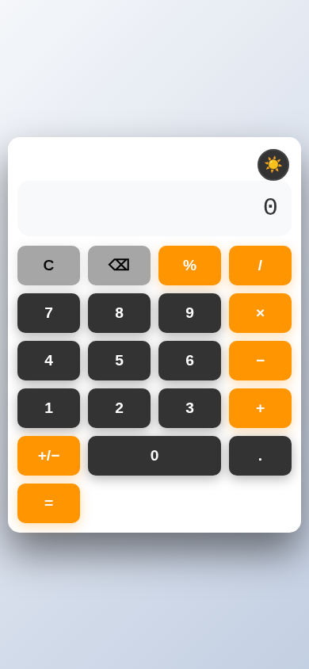
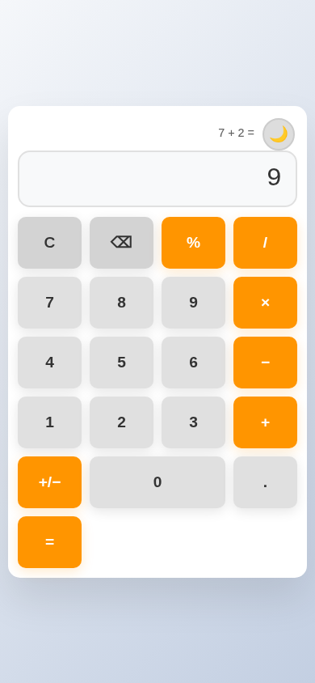

# Calculadora digital

Calculadora web hecha con HTML, CSS y JavaScript puro, pensada para usarse con comodidad desde el teléfono.

[](https://github.com/NickPro5677/Calculadora-digital/actions/workflows/test.yml)
[](LICENSE)

**Demo:** https://nickpro5677.github.io/Calculadora-digital/

<p>
  
  
</p>

## Para qué sirve

Hacer cuentas básicas en el navegador, con tema claro u oscuro, y sin instalar nada.

## Funciones

- Suma, resta, multiplicación y división, con operaciones encadenadas (`2 + 3 + 4 =` da `9`).
- Aviso claro al dividir entre cero.
- Decimales, cambio de signo (±), porcentaje y borrar el último dígito.
- Resultados redondeados para evitar errores como `0.1 + 0.2 = 0.30000000000000004`.
- Tema claro/oscuro que se recuerda entre visitas.
- Línea con la última operación realizada.
- Vibración al tocar los botones (en teléfonos compatibles).
- Soporte de teclado en computadora.

## Cómo usarla

**Desde el teléfono:** abre la [demo](https://nickpro5677.github.io/Calculadora-digital/) en el navegador. No hay que instalar nada.

**En una computadora:** descarga o clona el repositorio y abre `index.html` en el navegador (doble clic). No hace falta servidor.

```sh
git clone https://github.com/NickPro5677/Calculadora-digital.git
```

### Atajos de teclado

| Tecla | Acción |
|---|---|
| `0`–`9`, `.` o `,` | Escribir número / decimal |
| `+` `-` `*` (o `x`) `/` | Operadores |
| `Enter` o `=` | Calcular resultado |
| `Backspace` | Borrar último dígito |
| `Escape` o `Supr` | Limpiar todo (C) |
| `%` | Porcentaje |

## Estructura de archivos

```text
Calculadora-digital/
├── index.html          # La página (en la raíz, para GitHub Pages)
├── src/
│   ├── calc.js         # Lógica pura: operar y redondear (sin pantalla)
│   ├── script.js       # Botones, teclado, tema e historial
│   └── style.css       # Diseño y modo responsive
├── tests/              # Pruebas de calc.js con node --test
├── docs/               # Capturas
└── .github/workflows/  # CI: corre las pruebas en cada cambio
```

## Tecnologías

- HTML, CSS y JavaScript, sin librerías
- `node --test` para las pruebas (8 casos en `tests/calc.test.js`)
- GitHub Pages

## Historial guardado

Cada operación calculada se guarda en `localStorage` (clave `operationHistory`), limitado a las últimas 50. Ese historial no se muestra en la interfaz; en pantalla solo aparece la última operación. Para verlo, abre la consola del navegador y ejecuta:

```js
JSON.parse(localStorage.getItem('operationHistory'))
```

## Qué aprendí

- A manipular el DOM: leer y cambiar lo que se ve en pantalla desde JavaScript.
- A usar eventos de clic y de teclado para que la calculadora responda.
- A guardar datos en el navegador con `localStorage` (el tema y el historial).
- A hacer un diseño responsive con CSS para que funcione bien en el teléfono.
- Que los números flotantes no son exactos (`0.1 + 0.2`) y cómo redondear el resultado.

## Pruebas

```bash
npm test
```

GitHub Actions corre las pruebas en cada push y en cada pull request.

## Estado

Activo. No hay issues abiertos ni *releases* publicadas.

## Licencia

Distribuido bajo la licencia [MIT](LICENSE).
